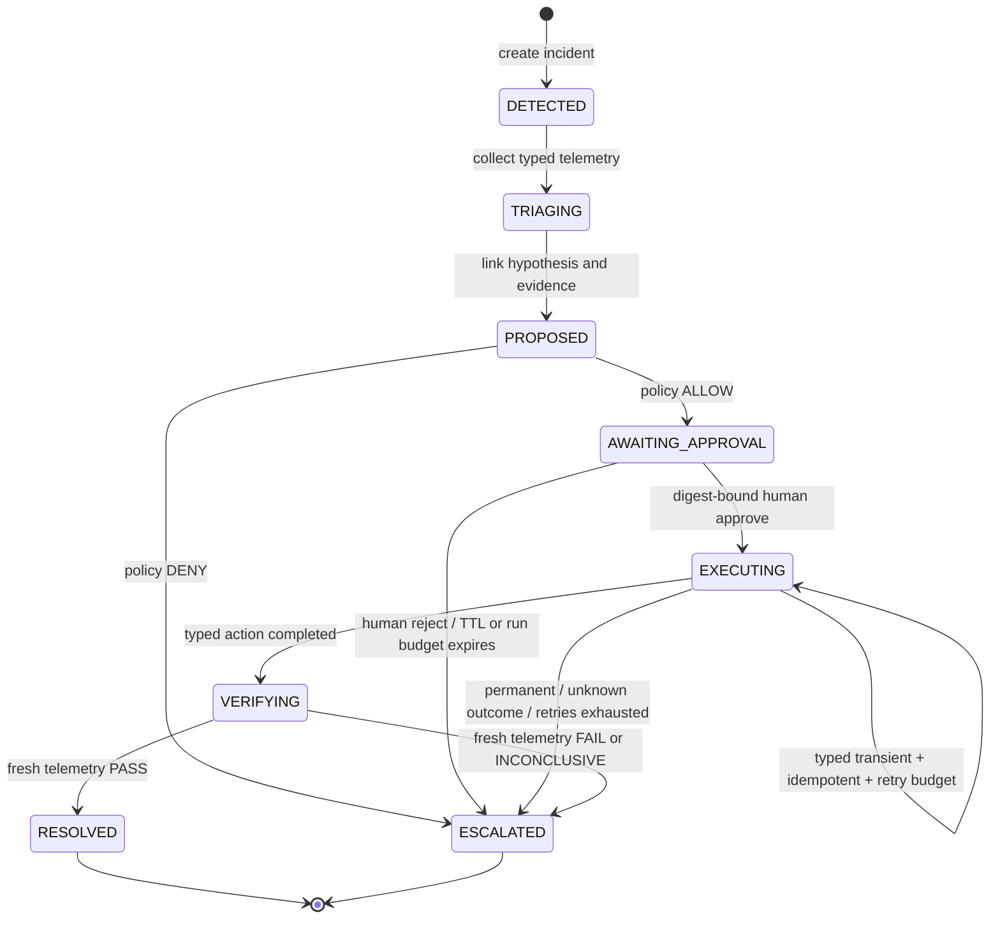

# IncidentPilot

IncidentPilot is a local-first incident decision-support MVP that demonstrates **bounded, human-gated remediation**. It turns deterministic synthetic telemetry into evidence-linked triage, proposes one allowlisted action, stops at `AWAITING_APPROVAL`, binds a human decision to an exact SHA-256 digest and TTL, executes only a typed demo action, and resolves only when a separate verifier sees fresh SLO recovery.

There is no LLM, cloud service, database, arbitrary shell, or paid dependency. The deterministic baseline costs **$0.0000** and makes every safety invariant easy to inspect in an interview.

## What the demo proves

- Synthetic scenarios produce typed metric, dependency, config, and log observation envelopes.
- Logs are explicitly `UNTRUSTED_DATA`; their content is displayed as inert text and never interpreted as instructions.
- Triage and proposals cite observation IDs that exist in the incident evidence ledger.
- Policy and executor maintain independent exact allowlists for three isolated demo actions.
- Approval is bound to the proposal ID, action, policy digest, evidence set, expiry, and run deadline.
- Only typed transient failures on known-idempotent actions may consume the bounded retry budget.
- Executor success cannot resolve an incident. A separate verifier obtains fresh telemetry and recomputes every SLO check.
- `FAIL` and `INCONCLUSIVE` verification outcomes stop in `ESCALATED`; the MVP never auto-replans.
- Audit events are append-only defensive copies with sequence numbers and a SHA-256 hash chain.
- The dashboard surfaces each event timestamp and digest plus the current terminal chain anchor for direct audit inspection.
- Every deterministic stage records a `$0` cost-ledger entry.

## Architecture

```mermaid
flowchart LR
    Browser["Static dashboard"] -->|same-origin JSON| HTTP["Go HTTP boundary"]
    CLI["curl / API client"] --> HTTP

    subgraph Boundary["Hardened request boundary"]
        HTTP --> Validate["4 KiB limit · strict JSON · typed validation"]
        Validate --> Guard["origin guard · rate limit · generic errors"]
    end

    Guard --> Loop["Bounded incident service"]
    Scenario["Synthetic scenario telemetry"] --> Collector["Typed observation collector"]
    Collector --> Loop
    Loop --> Triage["Deterministic evidence-linked triage"]
    Triage --> Policy["Deterministic policy allowlist"]
    Policy --> Stop["AWAITING_APPROVAL"]
    Stop -->|exact digest + TTL| Human["Human approve / reject"]
    Human -->|approve| Executor["Independent typed-action allowlist"]
    Human -->|reject| Escalated["ESCALATED"]
    Executor --> Probe["Fresh synthetic SLO probe"]
    Probe --> Verifier["Independent threshold verifier"]
    Verifier -->|PASS| Resolved["RESOLVED"]
    Verifier -->|FAIL or INCONCLUSIVE| Escalated

    Loop <--> Store["Immutable-copy in-memory repository"]
    Store --> Audit["Hash-linked append-only event history"]
    Store --> Costs["$0 deterministic cost ledger"]
```



The verifier deliberately receives the scenario fixture—not the executor result—so “action returned success” can never masquerade as recovery.

## State machine



Budgets are created once with the incident and cannot reset inside a run. The MVP intentionally permits one remediation iteration; a failed verification requires a new, human-owned response path rather than silent autonomous replanning.

## Run locally

Requirements: Go 1.26.6 or newer within the Go 1.26 release line.

```bash
make run
```

Open [http://127.0.0.1:8080](http://127.0.0.1:8080), choose a scenario, inspect the untrusted log and linked evidence, then approve or reject the proposal.

To listen on another address:

```bash
INCIDENTPILOT_ADDR=0.0.0.0:9090 make run
```

Run the full quality gate:

```bash
make check
```

The gate checks formatting, `go vet`, all tests, the race detector, an 80% aggregate coverage floor, and the production binary. The repository currently clears that floor without generated mocks or external packages.

Run the separately networked dependency and reachable-code audit:

```bash
make audit
```

`make audit` runs the pinned `govulncheck` v1.6.0 tool. It stays outside `make check` so the normal local quality gate remains deterministic and usable without network access; CI runs both gates.

## Docker

```bash
docker build -t incidentpilot:local .
docker run --rm -p 127.0.0.1:8080:8080 incidentpilot:local
```

The final image is `scratch`, runs as UID/GID `65532`, embeds the UI, and exposes only the Go binary. The container listens on all container interfaces so Docker networking works, while the publish command deliberately binds the host side to loopback; do not publish this unauthenticated local demo on a public interface.

CI also builds and smoke-tests this image with a read-only root filesystem, a temporary `/tmp`, `no-new-privileges`, all Linux capabilities dropped, and host publishing restricted to `127.0.0.1`.

## API

All responses use a typed envelope:

```json
{"success":true,"data":{}}
```

```json
{"success":false,"error":{"code":"invalid_request","message":"The request could not be processed.","request_id":"req-…"}}
```

| Method | Path | Purpose |
|---|---|---|
| `GET` | `/api/health` | Liveness and deterministic-mode status |
| `GET` | `/api/scenarios` | List bundled synthetic scenarios |
| `POST` | `/api/incidents` | Create and synchronously advance to the approval stop |
| `GET` | `/api/incidents/{id}` | Read an immutable incident snapshot |
| `POST` | `/api/incidents/{id}/approve` | Approve the exact proposal digest and run the typed action |
| `POST` | `/api/incidents/{id}/reject` | Reject the exact proposal digest and escalate without execution |

Create an incident:

```bash
curl --fail-with-body \
  -H 'Content-Type: application/json' \
  -d '{"scenario_id":"checkout-latency"}' \
  http://127.0.0.1:8080/api/incidents
```

Approval body (copy the `proposal.id` and `proposal.digest` returned above):

```json
{
  "proposal_id": "prop-…",
  "proposal_digest": "sha256:…",
  "actor": "demo.operator"
}
```

Rejection adds a required `reason` string. Unknown JSON fields, multiple JSON values, wrong media types, invalid identifiers, control characters, and bodies over 4 KiB are rejected. Browser mutations must be same-origin; non-browser local clients may omit `Origin`. State-changing routes share a bounded, per-remote-address in-memory rate limiter.

## Security model

The application is intentionally a **single-process local demo**, not a production SRE control plane.

- No authentication is included. Bind to the default loopback address for local use.
- The approval `actor` is a self-asserted audit label, not a verified identity, and the rate limiter is per-process and in-memory. Both are local-demo controls only.
- No CORS headers are emitted. Browser mutations enforce `Origin` and Fetch Metadata.
- The CSP forbids inline/evaluated script and inline style; UI rendering uses `textContent`, including for untrusted logs.
- CSP, frame denial, MIME sniffing protection, restrictive permissions, referrer policy, and cross-origin isolation headers are applied centrally.
- The action schema has no shell command, URL, script, or arbitrary parameter field.
- Policy ALLOW is not sufficient: the executor repeats an independent exact action/target/transition allowlist.
- Approval must match a recomputed proposal digest and a current policy digest before execution.
- Unknown execution outcomes are never retried. Only typed transient failures on idempotent demo actions may retry.
- API errors are generic; server-side errors never return stacks or raw internal messages.

If this demo is publicly hosted, expose only a read-only UI and read-only API routes. Enabling public mutation routes requires real authentication, per-action authorization, trusted approval identity, and a shared rate limiter first. Production evolution would also add durable transactional storage, signed audit checkpoints, real read-only telemetry adapters, and deployment-specific authorization before connecting any real actuator.

## Project map

```text
cmd/incidentpilot/       process entrypoint and graceful shutdown
internal/app/            validated config and defensive HTTP server timeouts
internal/core/           state machine, scenarios, policy, executor, verifier, store
internal/httpapi/        strict API boundary, rate limit, origin and security controls
internal/webui/          embedded dependency-free dashboard
docs/                    ADR and interview/demo guide
```

## Design notes

- [ADR-001: bounded loop and deterministic policy](docs/ADR-001-bounded-loop-policy.md)
- [Interview and demo guide](docs/INTERVIEW_GUIDE.md)

## Deliberate MVP limits

Incidents reset on process restart; the limiter is per process; telemetry and remediation are synthetic; and terminal escalation has no separate “human closed” endpoint. A final human closure transition is the next workflow phase, after durable identity and storage exist. These constraints keep the safety story honest while preserving the complete bounded demo path requested here.

## License

[MIT](LICENSE) © 2026 Dheeraj Mamidi.
